<p align="center">
  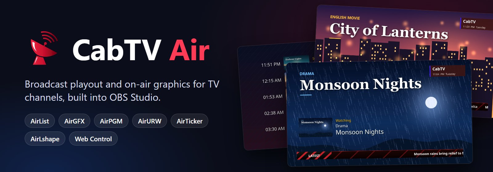
</p>

<p align="center">
  <a href="https://github.com/rubeldbc/cabtv-air-release/releases/latest"></a>
  
  
  <a href="https://github.com/rubeldbc/cabtv-air-release/releases"></a>
</p>

<p align="center">
  <a href="https://github.com/rubeldbc/cabtv-air-release/releases/download/v1.0.0-2026.10.27/cabtv-air-1.0.0-windows-x64-setup.exe"><b>⬇ Download the setup (200 MB)</b></a>
  &nbsp;·&nbsp; <a href="#4-install-step-by-step">Install</a>
  &nbsp;·&nbsp; <a href="#6-tutorial-your-first-broadcast">Tutorial</a>
  &nbsp;·&nbsp; <a href="#13-troubleshooting">Troubleshooting</a>
  &nbsp;·&nbsp; <a href="#15-whats-new">What's new</a>
</p>

---

**CabTV Air** is a broadcast playout and on-air graphics system for TV channels, built on **OBS Studio**. One setup
installs OBS Studio with CabTV Air inside it: a gap-free playlist with schedules and an as-run log, a designer for every
on-air graphic, a news ticker, a daily *Auto Playlist*, web pages for the newsroom and the control room, and one database
for every record. There is nothing to configure by hand and no command to type.

<p align="center">
  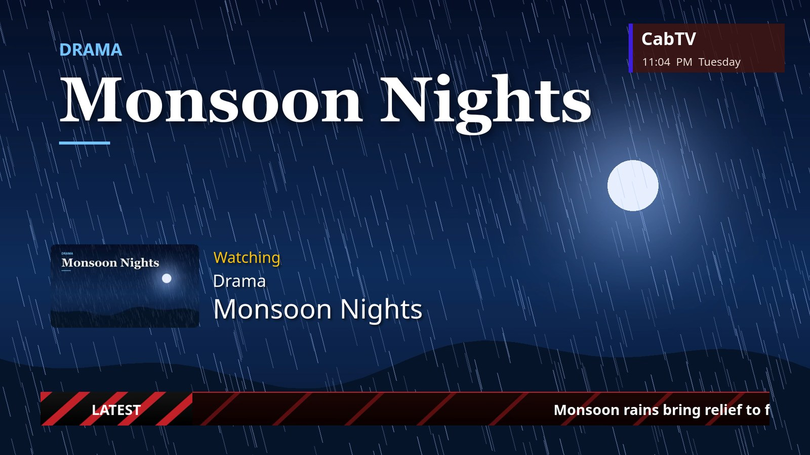
  <br><sub><i>On air: a movie from the playlist, with an <b>AirGFX</b> channel bug and clock, the <b>AirURW</b> “Watching” lower third and the <b>AirTicker</b> news ticker — all bound to the clip.</i></sub>
</p>

> [!NOTE]
> This repository publishes the **Windows installer** of CabTV Air. The source code is not published here.

## Contents

1. [What CabTV Air does](#1-what-cabtv-air-does)
2. [A tour in pictures](#2-a-tour-in-pictures)
3. [System requirements](#3-system-requirements)
4. [Install, step by step](#4-install-step-by-step)
5. [What the setup installs](#5-what-the-setup-installs)
6. [Tutorial: your first broadcast](#6-tutorial-your-first-broadcast)
7. [Working in the designers](#7-working-in-the-designers)
8. [The Auto Playlist](#8-the-auto-playlist)
9. [Web Control: the newsroom and control-room pages](#9-web-control-the-newsroom-and-control-room-pages)
10. [Settings reference](#10-settings-reference)
11. [Donation (the licence of CabTV Air)](#11-donation-the-licence-of-cabtv-air)
12. [Update, uninstall and where everything is](#12-update-uninstall-and-where-everything-is)
13. [Troubleshooting](#13-troubleshooting)
14. [Frequently asked questions](#14-frequently-asked-questions)
15. [What's new](#15-whats-new)
16. [Third-party software](#16-third-party-software)
17. [About this repository](#17-about-this-repository)

---

## 1. What CabTV Air does

CabTV Air adds its own sources to OBS Studio. Each one is added from OBS's **Sources → +** list.

| Source in OBS | What it is for |
| --- | --- |
| **CabTV AirList** | The playlist and playout: clips played back to back without a gap, cue and jump, live feeds, schedules, the as-run log, a clip library in its own database, the **CountDown** window for any row, saved playlists, and the **Auto Playlist** that builds a day's rundown from chunks, movies, fillers and commercials. |
| **CabTV AirGFX** | A graphics designer for on-air graphics: shapes, paths, texts, clocks, countdowns, pictures, videos and web pages, in groups that come and go by their own animations, bound to the clips they belong to — with a *Lead* to start before their clip. |
| **CabTV AirPGM** | A full-screen programme card such as *Coming up next*, placed in the playlist before a movie. Its texts and thumbnails read the next movies straight from the playlist. |
| **CabTV AirURW** | The *You are watching* graphic: the movie's thumbnail, its prefix and its name — as a lower third over the movie, or as a card made from an excerpt of the movie. |
| **CabTV AirTicker** | A news ticker of a header and a crawl, fed from a text file, a Google Sheet or its own web page — ten ready looks, in English and in Bengali. |
| **CabTV AirLshape** | An L-shaped frame (DownStream) that squeezes the programme picture to make room for graphics. |

It also brings:

- **Web pages** for the newsroom and the control room — *News*, *History*, *Log*, *Control* and *Administration* —
  opened in any browser on the PC or the local network, each user with their own rights.
- **One database for every record** — clips, playlists, schedules, rundowns, the graphics' presets, the logs —
  installed with it and ready, with nothing to set up.
- **Media found wherever it stands**: a design's pictures and videos are found again if the install moves; a file
  found nowhere is asked for once (*Locate…*), and until then drawn as a plain colour — never an error on air.
- **Bengali, English and Arabic text** with their own fonts and numerals, side by side in the same line.

## 2. A tour in pictures

<table>
  <tr>
    <td width="50%" valign="top">
      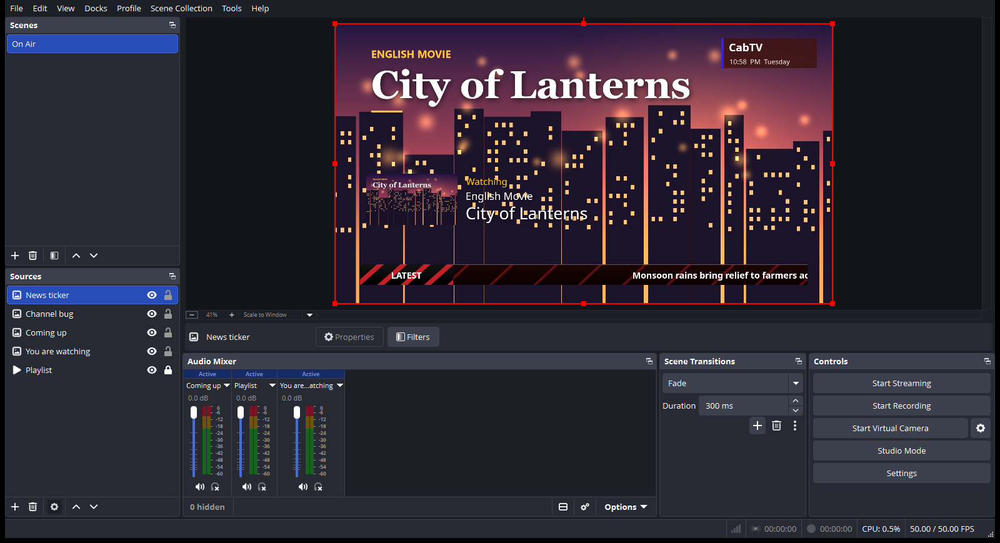
      <p align="center"><b>Inside OBS Studio</b><br><sub>The CabTV Air sources are ordinary OBS sources: shown, hidden, ordered and filtered as any other.</sub></p>
    </td>
    <td width="50%" valign="top">
      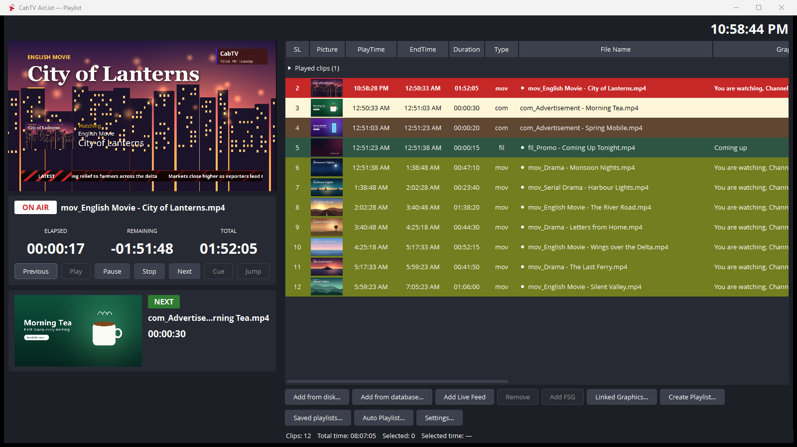
      <p align="center"><b>CabTV AirList</b><br><sub>The on-air monitor and tally, the transport, the next clip, and the playlist coloured by type with each row's thumbnail and bound graphics.</sub></p>
    </td>
  </tr>
  <tr>
    <td width="50%" valign="top">
      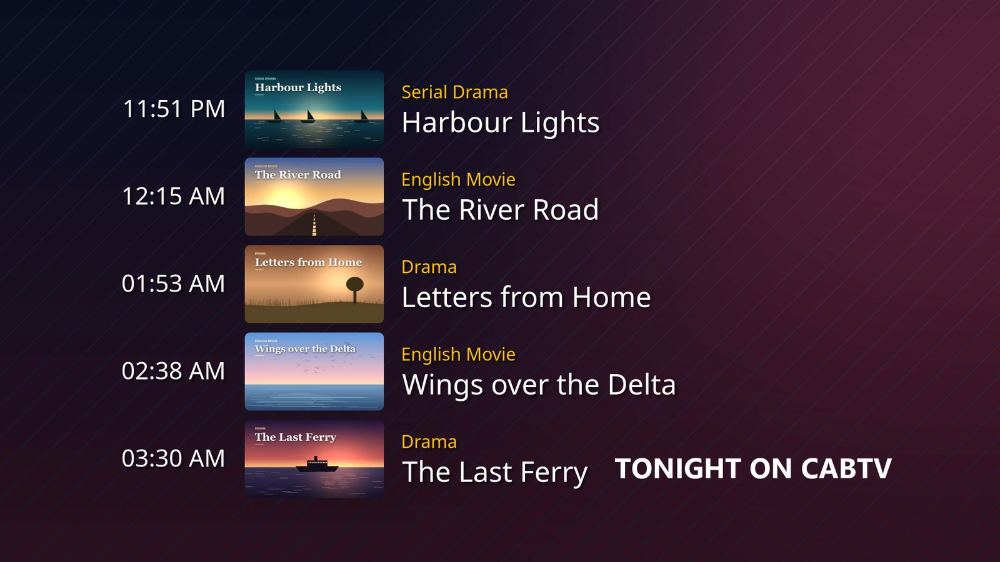
      <p align="center"><b>CabTV AirPGM on air</b><br><sub>A <i>Coming up</i> card that reads the next movies, their air times and thumbnails from the playlist.</sub></p>
    </td>
    <td width="50%" valign="top">
      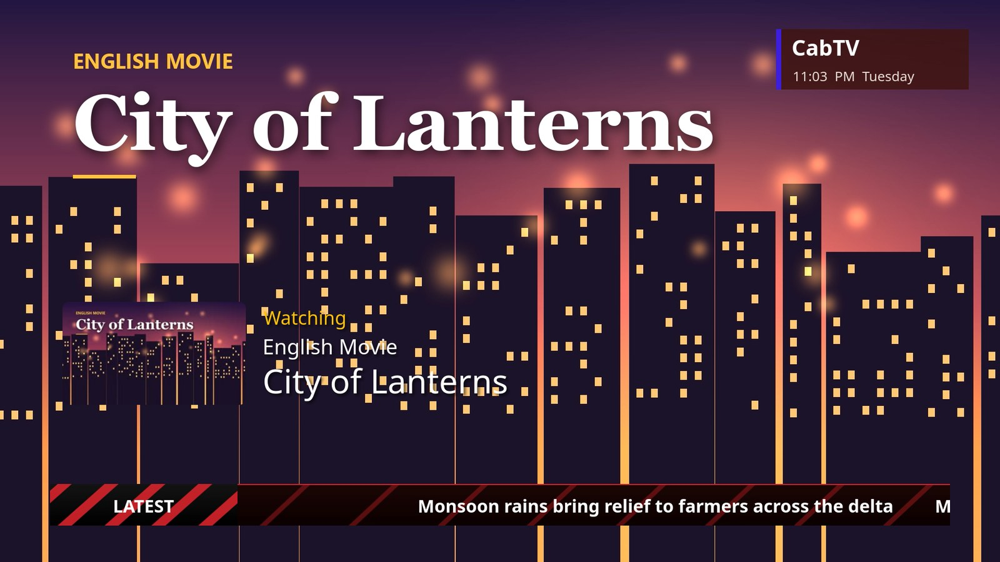
      <p align="center"><b>CabTV AirURW, AirGFX and AirTicker on air</b><br><sub>The lower third, the channel bug with its clock and the crawl, each shown with the clips that bind it.</sub></p>
    </td>
  </tr>
  <tr>
    <td width="50%" valign="top">
      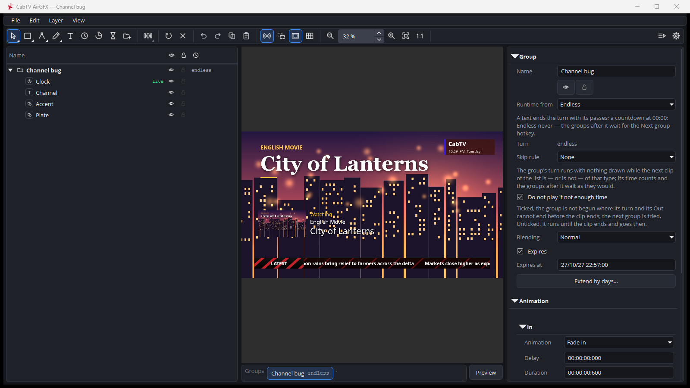
      <p align="center"><b>The AirGFX designer</b><br><sub>Layers and groups at the left, the canvas over the live programme, every setting at the right.</sub></p>
    </td>
    <td width="50%" valign="top">
      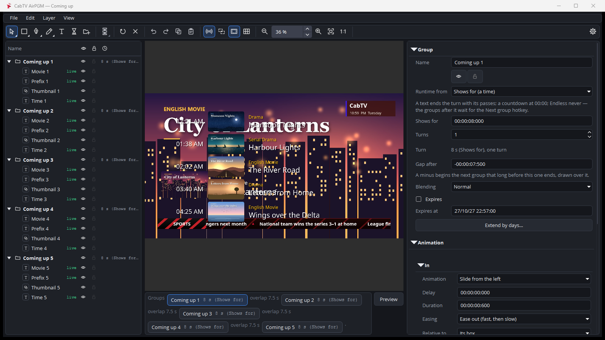
      <p align="center"><b>The AirPGM designer</b><br><sub>A new AirPGM starts with a ready <i>Coming up</i> card of five rows that come in one after another.</sub></p>
    </td>
  </tr>
  <tr>
    <td width="50%" valign="top">
      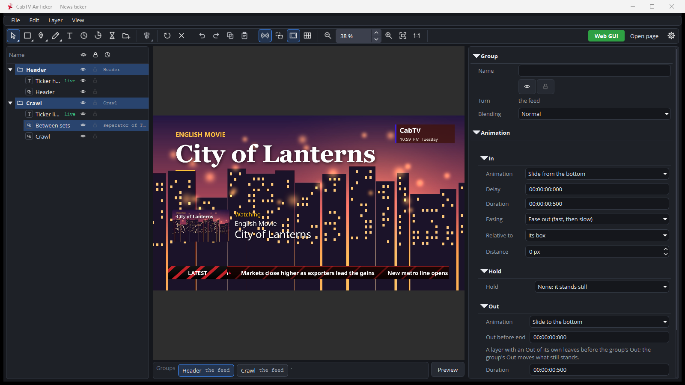
      <p align="center"><b>The AirTicker designer</b><br><sub>The Header and the Crawl, the <b>Web GUI</b> light and <b>Open page</b> on the toolbar.</sub></p>
    </td>
    <td width="50%" valign="top">
      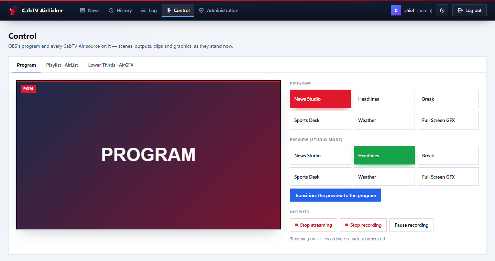
      <p align="center"><b>Web Control</b><br><sub>The programme, the playlist and the graphics, controlled from a browser by those allowed to.</sub></p>
    </td>
  </tr>
</table>

<p align="center">
  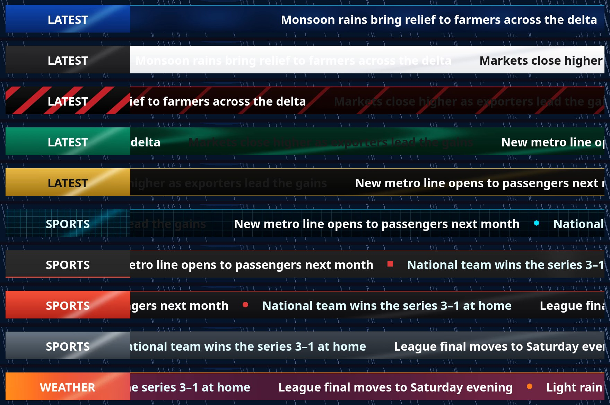
  <br><sub><i>The ten looks CabTV AirTicker ships with — Blue Night, Clean White, Crimson Edge, Emerald, Gold Prime, Neon Grid, Pure Minimal, Red Band, Steel and Sunset — each in English and in Bengali.</i></sub>
</p>

## 3. System requirements

| | |
| --- | --- |
| **Windows** | Windows 10 or Windows 11, 64-bit |
| **Processor** | 64-bit (x64) |
| **Graphics** | A DirectX 11 graphics card (as OBS Studio needs) |
| **Disk** | About **1 GB** free on an **NTFS** drive (the database needs NTFS), plus room for your clips |
| **Rights** | An administrator account to run the setup, once |
| **Network** | Needed for the *Donation* (licence) check and for a Google Sheet feed; the web pages work on the PC itself and on the local network |

## 4. Install, step by step

### 4.1 Download

1. Open the **[Releases](https://github.com/rubeldbc/cabtv-air-release/releases)** page.
2. Under the newest release, click **`cabtv-air-1.0.0-windows-x64-setup.exe`** (about 200 MB).

| Release | File | SHA-256 |
| --- | --- | --- |
| **1.0.0** — 27 October 2026 | `cabtv-air-1.0.0-windows-x64-setup.exe` | `fe9a300010340d28852492311692da8df255549c191b6fa686d46c2b48abfaae` |

<details>
<summary><b>For IT staff: checking the download's fingerprint</b></summary>

In PowerShell, in the folder you downloaded to:

```powershell
Get-FileHash .\cabtv-air-1.0.0-windows-x64-setup.exe -Algorithm SHA256
```

The *Hash* shown must match the SHA-256 above exactly. If it does not, delete the file and download it again.
</details>

### 4.2 Run the setup

1. **Close OBS Studio** if it is open — any OBS on the PC. The setup will not continue while OBS runs; it asks you to
   close it and press **Retry**. It never closes OBS for you: an OBS may be on air.
2. **Run** `cabtv-air-1.0.0-windows-x64-setup.exe` and allow it to make changes (**Yes**).
   - Windows **SmartScreen** may show *“Windows protected your PC”*, because the setup is not code-signed. Click
     **More info**, check that the file is the one you downloaded from this page, then **Run anyway**.
3. **Select Destination Location** — `D:\CabTV Air` is proposed (when the PC has a fixed D: drive formatted NTFS;
   otherwise `C:\CabTV Air`). Keep it, or click **Browse…** and choose any other folder. A drive that is not NTFS is
   refused, with a message saying so.
4. **Select Additional Tasks**
   - *Create a desktop shortcut* — ticked.
   - *Remove the older OBS AirList and CabTV AirTicker plugins* — shown only where they are installed; CabTV Air
     replaces both.
5. **Install.** The setup lays OBS Studio, CabTV Air and the database, installs the Microsoft runtime if the PC needs
   it, and sets the database's rights for every user of the PC.
6. **Finish** — leave **Start CabTV Air** ticked to start it straight away.

> [!TIP]
> An earlier install of CabTV Air in OBS's own plugins folder is moved into the new folder by the setup, its records
> with it. The old records are also kept where they were.

## 5. What the setup installs

One `setup.exe` does everything a PC needs:

| Part | Notes |
| --- | --- |
| **OBS Studio 32.2.2** | Portable, in its own folder — separate from any other OBS on the PC. CabTV Air is inside it. OBS's own update check is off here: a newer OBS comes with a newer CabTV Air setup, tested with it. |
| **CabTV Air** | The plugin, its data, its designs and its web pages. |
| **The database** | PostgreSQL, empty at the first install, **never written over** by a later setup. |
| **Microsoft Visual C++ runtime** | Needed by OBS and the database; installed only if the PC does not have it. |
| **Shortcuts** | **CabTV Air** on the desktop and in the Start menu. |
| **Uninstaller** | Listed in Windows' *Installed apps*. |

## 6. Tutorial: your first broadcast

This walk-through takes a fresh install to a channel on air: a playlist of movies and commercials, a channel bug with a
clock, a *You are watching* lower third, a *Coming up* card and a news ticker.

### Step 1 — Start CabTV Air

1. Start **CabTV Air** from its desktop shortcut or the Start menu. This is OBS Studio with CabTV Air inside it.
2. OBS's first-run wizard may appear — you can cancel it.
3. Set your canvas in **Settings → Video** if it is not 1920 × 1080 already (CabTV Air's designs are made for 1080p).

### Step 2 — Add the playlist (CabTV AirList)

1. In OBS's **Sources** box click **+** and choose **CabTV AirList**. Name it, for example *Playlist*.
2. Double-click it to open the **AirList window**. It opens as large as the screen the first time; **F11** gives it
   the whole screen and **Escape** takes it back. Closing the window only puts it away — the list plays on.

<p align="center"></p>

What the window shows:

- **The monitor** (top left) — what OBS puts on air, always: the scene on programme, with every graphic on it.
- **The on-air card** — the **ON AIR** tally (blinking white and red while the list plays; **OFF AIR** in black on
  yellow otherwise), the clip's name, the **ELAPSED**, **REMAINING** and **TOTAL** counters, and the transport.
- **The NEXT card** — the clip waiting to come on, with its first frame and its duration; a cued clip stands there
  under **CUED** with a countdown.
- **The list** (right) — each row's **SL**, **Picture**, **PlayTime**, **EndTime**, **Duration**, **Type**, **File
  Name** and **Graphics**, coloured by its type; and under it the buttons and the status bar (*Clips*, *Total time*,
  *Selected*, *Selected time*).

### Step 3 — Name and add your clips

CabTV Air reads each clip's **type**, **prefix** and **screen name** from its file name:

```text
type_prefix - screen name.ext

mov_English Movie - City of Lanterns.mp4      → type mov, prefix “English Movie”, screen name “City of Lanterns”
com_Advertisement - Morning Tea.mp4           → type com (commercial)
fil_Promo - Coming Up Tonight.mp4             → type fil (filler)
```

The screen name is what goes on air (in AirPGM, AirURW and the CountDown); the prefix says what kind of programme it
is. You do not have to rename files by hand:

1. Click **Add from disk…** and choose your files. They open in the **preliminary list**, where each one is given its
   **Type**, **Prefix** and **Screen name** before it enters the playlist. Saving there renames the file to the
   format and records it in the clip library.
2. **Add from database…** adds clips you have used before, searched by any word of their screen name, prefix or file
   name.
3. **Add Live Feed** adds a live source of your scenes — a capture card, a browser, a display or window capture — as a
   row of its own, with a production name and a duration.

<details>
<summary><b>Tip: let an AI suggest the screen names</b></summary>

In the preliminary list, tick the rows and choose **Copy List with AI Prompt** from its menu: the file names go to the
clipboard together with the prompt of **Settings › AI Prompt**. Paste that into the AI chat you use, copy its answer,
and choose **Paste Screen Name** — each ticked row takes its name, checked by the same rules as a typed one.
</details>

### Step 4 — Run the playlist

| Button | What it does |
| --- | --- |
| **Play** | Starts at the selected pending row (or the first pending row); on a paused list runs on from where it stood. |
| **Pause** | Holds the clip on air on its frame, silent; the times below slide while the pause lasts. |
| **Stop** | Stops the list. |
| **Next** | Ends the clip on air and starts what follows at once — the cued row when there is one. |
| **Previous** | Plays the clip played before again, from its start. |
| **Cue** | The selected row follows the clip on air, wherever it stands in the list; after it, the list goes on below it. |
| **Jump** | The selected row plays **now**. |

A row's **right-click menu** holds the rest: *Move up / Move down*, *Copy / Paste*, **Source binding…**,
**Clip Editor…** (frame, in and out points, gain), **Clip Splitter…**, **CountDown…**, **Add FSG…**, *Clear played*,
*Clear all*, and the playlists' entries.

**The CountDown window** (a row's **CountDown…**) shows that row's serial, its screen name and the time until it
begins, in large type, on top of every other window — for the studio or the master control room:

<p align="center">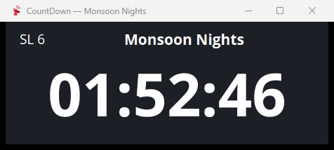</p>

**Saved playlists**: **Create Playlist…** opens a playlist editor beside the running list (nothing in it plays);
**Save** keeps it in the database under its name. **Saved playlists…** lists them — **Append** adds one to the end of
the running list, **Replace** puts it in the running list's place.

### Step 5 — A channel bug and a clock (CabTV AirGFX)

> [!IMPORTANT]
> **A new graphic comes onto the scene hidden** (its eye is off), so nothing appears on air by surprise. Click its
> **eye** in OBS's Sources list when you are ready to show it. This holds for every designer's source.

1. In **Sources**, click **+** → **CabTV AirGFX**, and name it *Channel bug*. Click its **eye** to show it.
2. Double-click it to open the **AirGFX designer**. Draw a rectangle for the plate, a **Text** with your channel's name,
   and a **Clock** (the clock tool on the toolbar). Drawing a clock makes its group **Endless**; drawing a
   **Countdown** sets its group to show for two minutes and the project's *Lead* to two minutes.
3. Give the group an **In** and an **Out** animation (for example *Fade in*), and press **Preview** to see them.

<p align="center"></p>

### Step 6 — *You are watching* (CabTV AirURW)

1. **Sources → + → CabTV AirURW**, named for example *You are watching*. A new AirURW starts with a **ready lower
   third** — the movie's thumbnail, *Watching*, its prefix and its name — and its designer opens by itself.
2. Its texts are **live**: they read the movie on air from the playlist. Restyle them as you like.
3. Show it with the movies — by [binding](#step-9--bind-graphics-to-clips) it to their rows. Or select movie rows
   and press **Add FSG**: a *You are watching* card is placed **before** each selected movie, made from an excerpt
   of the movie itself (no file is cut).

<p align="center">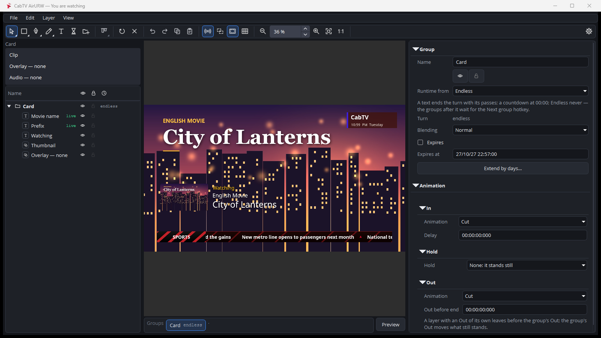</p>

### Step 7 — The *Coming up* card (CabTV AirPGM)

1. **Sources → + → CabTV AirPGM**, named for example *Coming up*. A new AirPGM starts with a **ready card**: five
   rows, each the air time, the thumbnail, the prefix and the name of a movie to come, sliding in one after another;
   10 seconds long.
2. Bind it to a short clip placed **before** a movie — a promo or a background loop. While that clip plays, the card
   reads the next movies from the playlist, with their real air times.
3. A text or a thumbnail that finds no movie is hidden on its own; the rest of the card still plays.

<p align="center"></p>

### Step 8 — The news ticker (CabTV AirTicker)

1. **Sources → + → CabTV AirTicker**, named for example *News ticker*. It is made of two groups that are always there:
   the **Header** and the **Crawl**.
2. Pick a look: **File ▸ Presets…** in its designer lists the twenty shipped designs (ten looks, each in English and
   in Bengali). Select one and press **Load**.

   <p align="center">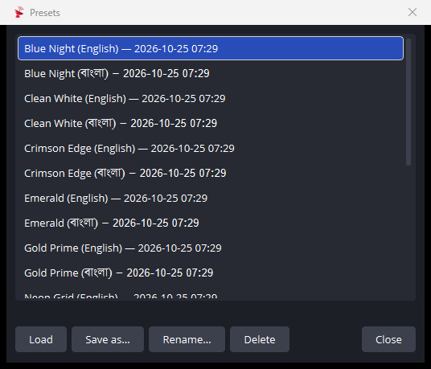</p>

3. Choose where the news comes from in its settings (⚙ → **Feed from**):

   | Feed | How it works |
   | --- | --- |
   | **Text file** | A UTF-8 text file. Each set is a header between two `===` lines, then its lines. A `#` before a header or a line switches it off. The ticker follows the file as you save it. |
   | **Google Sheet** | The sheet's link *published to the web as CSV*, read every *Poll every* seconds (30 by default). Columns **Header**, **Line** and **On** (*yes*, *1*, *on* or empty shows a line; anything else hides it). |
   | **Web GUI** | The ticker's own **News** web page — see [Web Control](#9-web-control-the-newsroom-and-control-room-pages). A new ticker starts here. |

   A text file of two sets:

   ```text
   ===
   LATEST
   ===
   Monsoon rains bring relief to farmers across the delta
   Markets close higher as exporters lead the gains
   ===
   খেলাধুলা
   ===
   বাংলাদেশ দল আজ মাঠে নামছে
   #This line is off for now
   ```

4. On its toolbar, the **Web GUI** button shows a light — **green** the web service runs, **yellow** it does not
   (press to run it), **red** something is wrong (press for its window) — and **Open page** opens the news page in
   the PC's browser.

### Step 9 — Bind graphics to clips

A graphic bound to clips is **on screen while those clips play and off with the others** — the channel bug and ticker
with the movies, the *Coming up* card with its promo, nothing over the commercials.

- **One row at a time** — the row's **Source binding…**: tick the sources to show while that clip plays.

  <p align="center">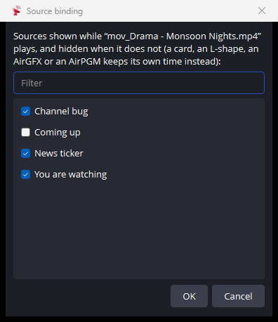</p>

- **Every clip of a type** — **Settings › Type**: choose the type (*mov*, *com*, *fil* …) and tick its **Default
  graphics**; every clip of that type added afterwards brings them.
- **Graphics that follow a graphic** — **Linked Graphics…**: the sources linked to a “mother” are shown while she is on
  the programme; on the *Unlinked* tab, sources are hidden while she plays (and come back after, with *Auto Return*).
- **Starting early** — an AirGFX's **Lead** (in its designer's ⚙ settings) starts it that long before its clip, however
  long the lead is: a graphic set two minutes before its movie stays ready through every clip of the break.

The **Graphics** column of the list shows what each row binds.

### Step 10 — Go on air

Press **Play** in the AirList window and start streaming or recording in OBS as usual (**Start Streaming**, **Start
Recording**, or an output plugin of your choice). The **as-run log** records what really played, when, and how it
ended. **Settings › General › Show Log** opens it on the **Log** web page.

## 7. Working in the designers

AirGFX, AirPGM, AirURW and AirTicker share one designer.

| Part of the window | What it holds |
| --- | --- |
| **Toolbar** | Selection, shapes, the pen and pencil, text, clock, countdown, delay, a new group; undo and redo, copy and paste; the safe frame, the grid, the zoom; the project's settings (⚙). |
| **Layers** (left) | The groups and their layers, each with its eye and lock; **live** marks a text that reads its words from the playlist or the feed. |
| **Canvas** (middle) | The design at its place over the live programme. |
| **Settings** (right) | The chosen group's or layer's settings: name, place and size, fill, stroke and text; *Runtime from*, *Shows for*, *Turns*, *Gap after*, *Expires*; and its **Animation**. |
| **Groups** (bottom) | The groups in the order they play, with their times; **Preview** at the right. |

**Animation.** Every group and every layer has an **In**, a **Hold** and an **Out**: an animation from the one shared
list (fades, slides, wipes, letter by letter and more), its **Delay**, **Duration**, **Easing**, and for a travelling
animation **Relative to** (its box or the whole screen) and **Distance**. A text whose words change while it stands
(the ticker's header) also has a **Change Animation**.

**Preview** plays the In and holds the design until you press it again, then plays the Out — in the designer only,
never on air.

**Presets and files.** **File ▸ Presets…** keeps designs in the database (*Load*, *Save as…*, *Rename…*,
*Delete*). **File ▸ Export Project…** writes a design to a `.json` file with its pictures and videos in a folder beside
it, and **Import Project…** reads it on another PC. **Import SVG…** and **Export SVG…** exchange shapes with other
design tools.

## 8. The Auto Playlist

The **Auto Playlist** builds and loads each day's playlist by itself, from a **chunk structure** — the order of
movies, commercials, fillers, *You are watching* and *Coming up* cards inside a chunk of the day.

1. **Settings › Auto Playlist** — tick **Enable Auto Playlist** and set **Create and load playlist daily at** (05:00
   AM by default), the **Station ID**, how many chunks a day, and whether to use the backup filler and commercial lists
   when a day has none of its own.

   <p align="center">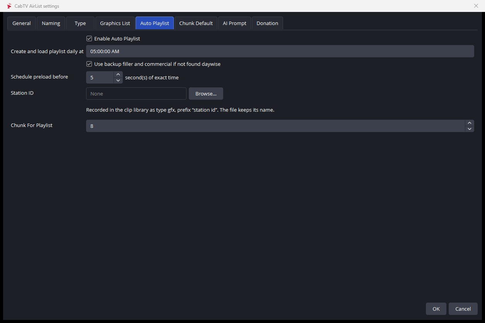</p>

2. **Settings › Chunk Default** — the chunk every new chunk starts from: its **Chunk Duration**, its **Flash back
   duration** and its **Chunk Structure** — rows of kinds (*Station ID*, *Movie Clip*, *URW*, *Commercial*, *PGM*,
   *Filler*), each with its duration and its graphics.

   <p align="center">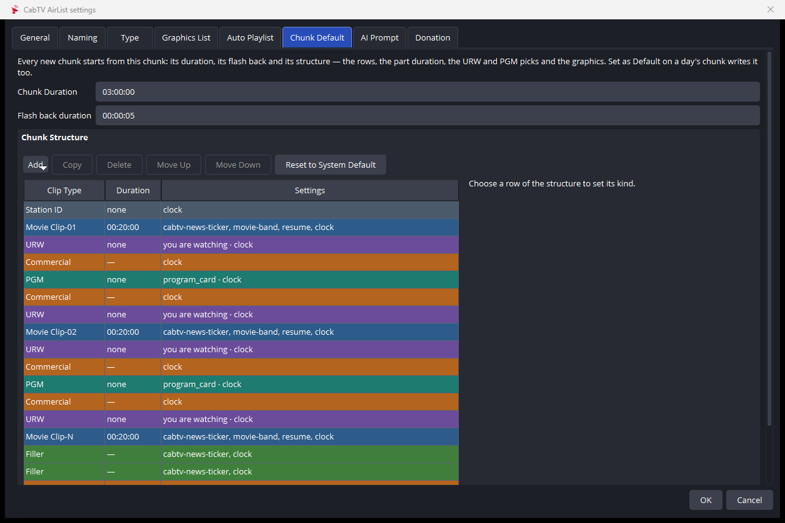</p>

3. **Auto Playlist…** in the AirList window opens the **calendar**: each day says whether its schedule is *Ready*,
   *Incomplete* or missing, with its chunks and its filler and commercial counts. **Backup Filler** and **Backup
   Commercial** hold the lists used when a day has none.

   <p align="center">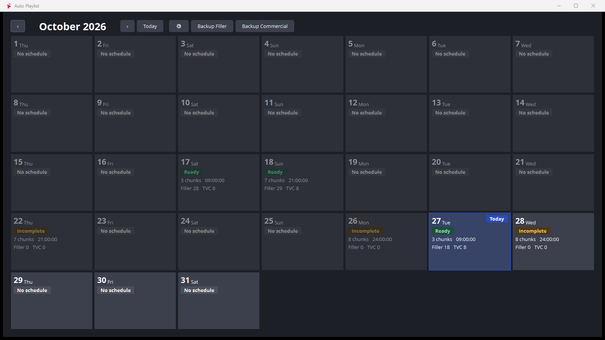</p>

4. Click a day to open its page: add its chunks (**Add Chunk…**), their movies, the day's **Filler Video** and
   **Commercial Video**, and press **Generate Rundown**. The rundown can be appended to the on-air list, whole or by
   the rows you choose.

## 9. Web Control: the newsroom and control-room pages

CabTV Air runs a small web service on the OBS PC. Its pages open in any modern browser — on the PC itself, or from
another PC, tablet or phone of the same network.

| Page | What it is for |
| --- | --- |
| **News** | The ticker's sets and lines: add, edit, reorder, skip or hide a line; see which line is **ON AIR** now. A change is on air from the next line that enters the screen. |
| **History** | What was done to the news and by whom, and what ran on air — the newest first. |
| **Log** | Every log of CabTV Air in one place — AirList as-run, AirTicker as-run, web activity, the controller, graphics runs, licence sync, deletions and exports, the web service and OBS — searched by time, words, source and outcome, and exported as CSV. |
| **Control** | OBS's programme and every CabTV Air source on it: scenes (programme and preview), the transition, streaming and recording, the playlist's transport, and the graphics' groups and names. |
| **Administration** | The users, their roles and their access to each page (*none*, *view* or *edit*), and the service's own settings. |

<p align="center">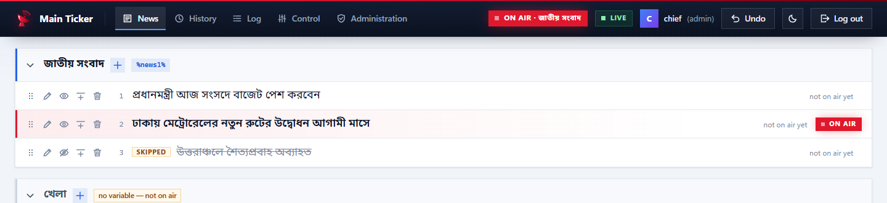</p>
<p align="center">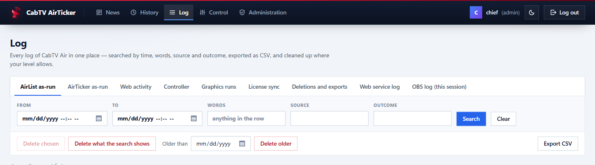</p>
<p align="center">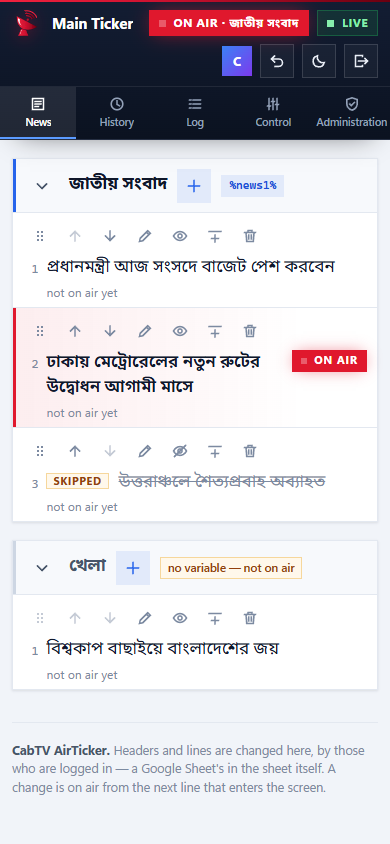<br><sub><i>The same News page on a phone.</i></sub></p>

**Getting started**

1. Open the AirTicker designer and press **Open page** on its toolbar (or **Show Log** in AirList's **Settings ›
   General**). The service starts if it does not run, and the page opens in the PC's browser.
2. **The first time, nobody can log in yet**: the first administrator is made on the news page **of this PC**. That
   user is the *super admin*, who always has every right.
3. In **Administration**, add the other users — a name, a role, a password of 8 characters or more — and give each
   one *none*, *view* or *edit* on **News**, **Log**, **Control** and **Admin**.
4. From another device, open the same address with the OBS PC's network address in place of `localhost`, on the port
   shown in **Administration › The service**. Windows may ask once whether to let the service through its firewall.

<p align="center">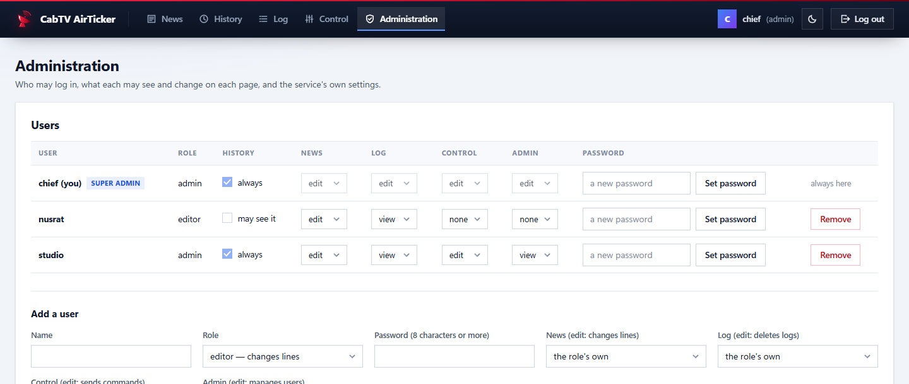</p>

The pages follow the PC's light or dark theme, and have a switch of their own.

## 10. Settings reference

Open **Settings…** in the AirList window. The settings are kept in the database and shared by every AirList source.

| Tab | What it sets |
| --- | --- |
| **General** | What a playlist that was playing does when OBS starts again (*stays stopped*, *resumes where it stopped*, *resumes by the time gap*); the default image duration; hardware decoding; *Loop the playlist*; *Show thumbnails in the playlist*; the **safe frame**; the clip thumbnails' size and crop, and **Clean thumbnails…**; **Maintenance** — *Remove Unwanted Sources* (names of sources that no longer exist, found and removed or replaced, *Include past days*) and **Show Log**. |
| **Naming** | The **prefixes** clips are named with (*Bengali Movie*, *English Movie*, *Drama*, *Advertisement* …) — add or delete. |
| **Type** | The **types** (`mov`, `fil`, `gfx`, `com`, `nws`, `liv`, `urw`, and your own) with their colours; each type's **default graphics**; which lists are coloured by type. |
| **Graphics List** | **Preload graphics** — how long before every automatic play pages and videos are made ready (3 s by default); the sources offered as *Other Graphics* in every designer. |
| **Auto Playlist** | See [The Auto Playlist](#8-the-auto-playlist). |
| **Chunk Default** | See [The Auto Playlist](#8-the-auto-playlist). |
| **AI Prompt** | The prompt used by *Copy List with AI Prompt* in the preliminary list; *Use Default* puts the default back. |
| **Donation** | This PC's **Donation ID** and the state of its licence — see below. |

<details>
<summary><b>Pictures of the General, Type and Graphics List tabs</b></summary>

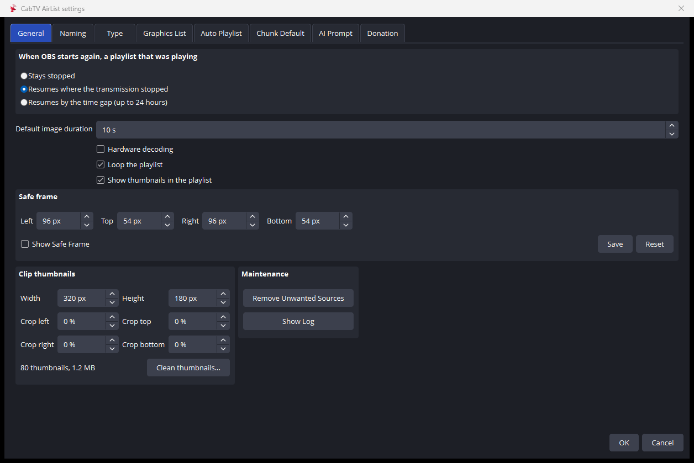
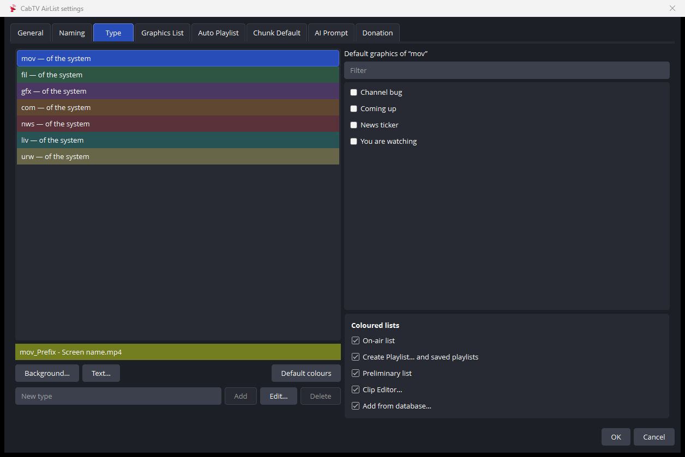
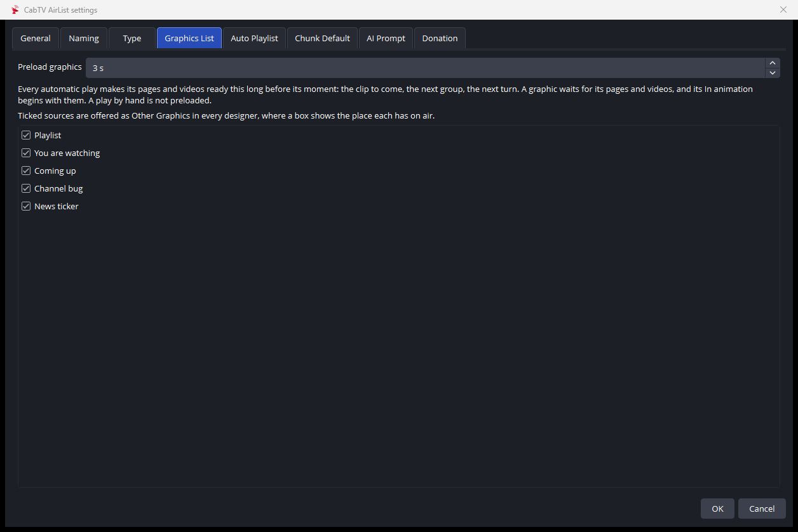
</details>

## 11. Donation (the licence of CabTV Air)

CabTV Air plays by an active **Donation**. Open the **AirList** window → **Settings…** → the **Donation** tab:

<p align="center">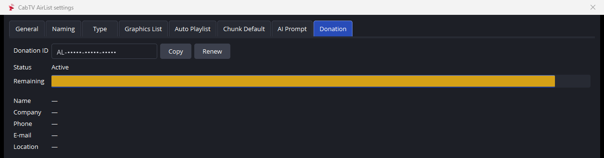</p>

- **Donation ID** — this PC's own ID. **Copy** it and send it to your CabTV Air provider to activate the PC.
- **Status** and **Remaining** — whether this PC's donation is active, and how much of it is left. **Renew** asks the
  donation server now: hours your provider has just given are taken at once, and nothing on air is touched.
- **Name**, **Company**, **Phone**, **E-mail**, **Location** — your details, given once when CabTV Air asks for them;
  it then takes its donation by itself.

Without an active donation, CabTV Air plays only a short round of clips — none on a PC that never had a donation — and
its graphics stay hidden. Reinstalling, updating or uninstalling CabTV Air **never removes** this PC's donation data.

## 12. Update, uninstall and where everything is

### Update to a newer setup

1. Download the newer setup from the [Releases](https://github.com/rubeldbc/cabtv-air-release/releases) page.
2. **Close CabTV Air (OBS).**
3. Run the new setup. It finds your install and keeps its folder.

| An update **keeps** | An update **replaces** |
| --- | --- |
| Your database (clips, playlists, schedules, rundowns, presets, logs), OBS's settings, your scene collections and profiles, and the donation | OBS's program files and CabTV Air's own files |

Running the same setup again is always safe — it also mends an install whose database rights went wrong.

### Uninstall

Open Windows **Settings → Apps → Installed apps**, find **CabTV Air**, and choose **Uninstall** (or use *Uninstall
CabTV Air* in the Start menu). Close CabTV Air first. The uninstaller asks: ***Delete CabTV Air's database and its OBS
settings too?***

- **No** (the default) — OBS and CabTV Air are removed; your **database and OBS settings are kept** in the install
  folder, for a later install to find.
- **Yes** — they are removed too.

The donation data is never removed.

### Where everything is

Inside the install folder (`D:\CabTV Air` by default):

| Folder | What it holds |
| --- | --- |
| `bin\64bit\obs64.exe` | OBS Studio — what the *CabTV Air* shortcut starts |
| `obs-plugins\64bit\` | OBS's plugins, CabTV Air's among them |
| `data\obs-plugins\cabtv-air\` | CabTV Air's data: its words, effects, designs and web pages |
| `config\` | OBS's settings, profiles and scene collections — **yours** |
| `pg\` | The database server |
| `pgdata\` | The database — **your records** |
| `uninstall\` | The uninstaller |
| `data\obs-studio\license\`, `OBS-SOURCE.txt` | OBS Studio's licence and where its source is |

The setup's own log (what it did, step by step) is written to Windows' temporary folder as *Setup Log ….txt*.

## 13. Troubleshooting

| What you see | What to do |
| --- | --- |
| The setup says **OBS is running** | Close every OBS on the PC, then press **Retry**. |
| The setup refuses the folder's drive | Choose a folder on an **NTFS** drive (most fixed drives are). |
| The setup says the **database is not ready** | Restart Windows and run the same setup again — your records are kept. |
| *“Windows protected your PC”* | **More info → Run anyway** (the setup is not code-signed; see [4.2](#42-run-the-setup)). |
| A new graphic does not appear | A new graphic comes onto its scene **hidden**: click its **eye** in OBS's Sources list. Then check it is bound to the clip on air. |
| A graphic does not appear with its clip | Check that the clip's row binds it (the row's **Source binding…**, or **Settings › Type**), and its *Lead* in the designer's ⚙ settings. |
| A clip or a design says *not saved: the database is not open* | Run the setup again over the install (it repairs the database's rights), then start CabTV Air. |
| A design's picture or video is missing | A window asks for it once: **Locate…** the folder where it now is (every other missing file of that folder is found too), or **Use a colour** for now. |
| The ticker shows the sample lines | Its feed is still the product's sample: choose your text file, sheet or the Web GUI under ⚙ → **Feed from**. |
| The web page does not open from another PC | Use the OBS PC's network address and the port shown in **Administration**, and allow the service in Windows' firewall. |
| Graphics stay hidden and only a few clips play | The donation is not active — see [Donation](#11-donation-the-licence-of-cabtv-air). |
| Something else | Send your CabTV Air provider OBS's log: in CabTV Air, **Help → Log Files → Upload Current Log File** (or *Show Log Files*). |

## 14. Frequently asked questions

<details>
<summary><b>Can I keep my own OBS Studio installed?</b></summary>

Yes. CabTV Air installs its own portable OBS Studio in its own folder; another OBS on the PC is not changed. Only one of
them should be on air at a time.
</details>

<details>
<summary><b>Which video files can I play?</b></summary>

Videos — MP4, MOV, MKV, MXF, TS, M2TS, MTS, MPG, AVI, WMV, FLV, WebM, M4V — in the codecs OBS Studio decodes;
images — PNG, JPG, BMP, TGA, WebP, GIF, PSD — each with its own duration; audio — MP3, WAV, FLAC, AAC, M4A, OGG,
Opus, WMA, AIFF; and live sources.
</details>

<details>
<summary><b>Does CabTV Air stream or record by itself?</b></summary>

No — it makes the programme, and OBS streams, records or sends it out as it always does: *Start Streaming*, *Start
Recording*, the virtual camera, OBS's Decklink output, or an output plugin of your choice.
</details>

<details>
<summary><b>Is my data stored online?</b></summary>

No. Every record is in the database on the PC, inside the install folder. The network is used for the donation check,
a Google Sheet feed if you choose one, and the web pages you open.
</details>

<details>
<summary><b>Can I move CabTV Air to another drive?</b></summary>

Install it there with the setup (choose the folder on *Select Destination Location*). A design's pictures and videos are
found again wherever they now stand; one found nowhere is asked for once.
</details>

<details>
<summary><b>Where are the extra designs?</b></summary>

The ticker's ten looks come with CabTV Air (**File ▸ Presets…** in the AirTicker designer). A release may also carry a
**design pack** — looping videos of frames and ticker sets for an OBS *Media Source* — as a second file beside the
setup; see its `README.txt`.
</details>

## 15. What's new

### 1.0.0 — 27 October 2026

The first public setup. Highlights of this build:

- **Installer** — OBS Studio 32.2.2 included, portable; `D:\CabTV Air` by default, any folder you choose; the database
  ready for every user; an earlier install moved in with its records.
- **AirGFX** — a graphic's **Lead** now works however long it is: a graphic set to start two minutes before its movie
  stays ready through every clip of the break and starts on time. Drawing a **Countdown** sets its group to show for
  two minutes and the project's Lead to two minutes; drawing a **Clock** makes its group endless.
- **AirPGM** — a new AirPGM starts with a ready *Coming up* card: the next five movies, each row with its air time,
  thumbnail, prefix and name, coming in one after another and going out in the same order; 10 seconds long.
- **AirURW** — a new AirURW starts with a ready lower third: the movie's thumbnail, *Watching*, its prefix and its
  name; 10 seconds long.
- **AirPGM and AirURW** — a text or thumbnail that finds no movie is hidden on its own; the rest of the card still
  plays.
- **AirList** — the **CountDown** window: a much larger time, the serial and the movie's name on one line, a smaller
  window. **Settings › General › Maintenance › Remove Unwanted Sources**: names of sources that no longer exist, found
  and removed or replaced — with *Include past days*. A renamed source is followed everywhere it is used.
- **Auto Playlist** — a chunk is never filled with the same card over and over when no filler or commercial list
  exists.

## 16. Third-party software

The setup includes, unchanged, each under its own licence:

| Software | Version | Licence | Source |
| --- | --- | --- | --- |
| OBS Studio | 32.2.2 | GNU GPL v2 or later | <https://github.com/obsproject/obs-studio> (also `OBS-SOURCE.txt` in the install) |
| PostgreSQL | 18.1 | PostgreSQL Licence | <https://www.postgresql.org/> |
| Node.js | 24.21.0 | MIT | <https://nodejs.org/> |
| Microsoft Visual C++ Redistributable | 2015–2022 | Microsoft's licence | <https://learn.microsoft.com/cpp/windows/latest-supported-vc-redist> |
| GNU FriBidi | — | GNU LGPL v2.1 or later | <https://github.com/fribidi/fribidi> |

OBS Studio is the work of the OBS Project and is not part of CabTV Air; CabTV Air is a plugin that runs inside it.

## 17. About this repository

- This repository holds **this README and its pictures** (`docs/images/`). Each release holds the **setup file** —
  its SHA-256 in the release's text — and may hold a design pack beside it. GitHub keeps files of that size in a
  release, not in the repository itself.
- **No source code of CabTV Air is published here.** The *Source code (zip)* and *(tar.gz)* links GitHub adds to every
  release by itself contain only this README and its pictures. Please do not open pull requests.
- The pictures were taken in CabTV Air 1.0.0 on a demo channel; the movies, names and news in them are made up for the
  pictures.
- Questions and support: your CabTV Air provider.

<p align="center"><sub>© 2026 Kamrul Islam Rubel. CabTV Air.</sub></p>
